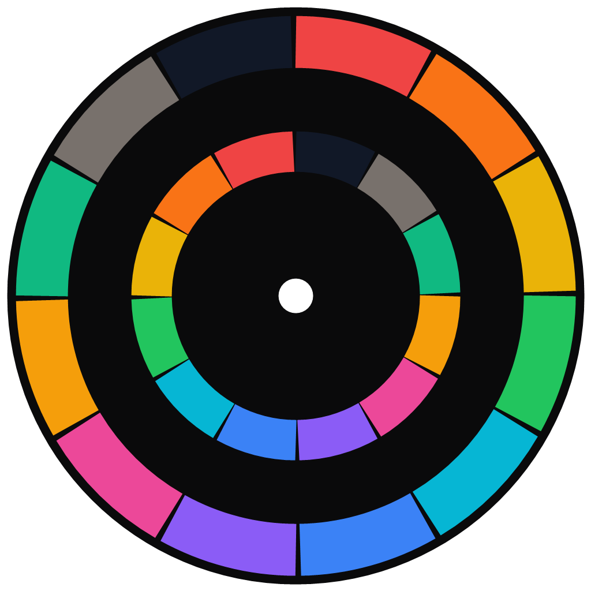
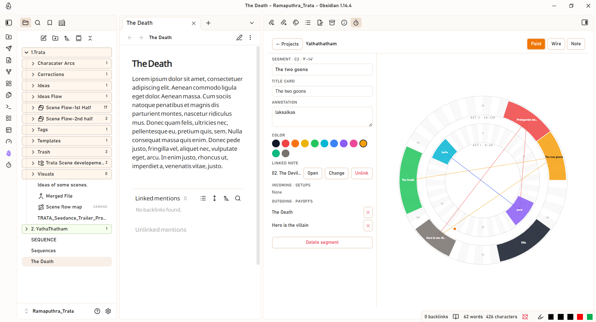
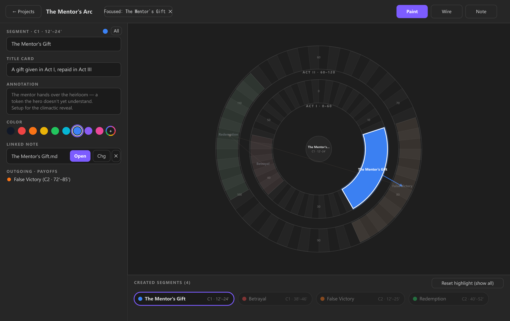
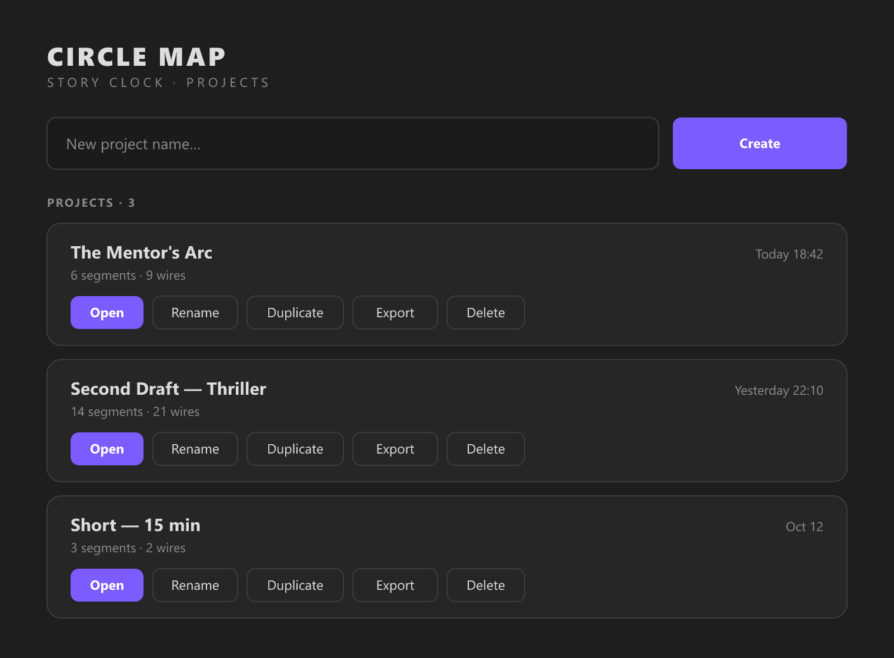

<p align="center">
  
</p>

# Story Clock

**Circle Map for Obsidian** — map your story's themes and *setup → payoff* threads onto a two-ring **story clock**, link every segment to a note, and open notes in a side panel.

A visual screenwriting / plotting tool that lives inside your vault, so your story structure sits right next to your notes.

<p align="center">
  <a href="https://buymeacoffee.com/ramaputhra" target="_blank" rel="noopener noreferrer">
    
  </a>
</p>

<p align="center">
  
</p>

<p align="center">
  
</p>

---

## ✨ Features

### 🕰️ The two-ring story clock
- **120 minutes, two acts** — an inner ring for **Act I · 0–60** and an outer ring for **Act II · 60–120**, each divided into 60 one-minute segments.
- Paint themes as colored arcs and connect them with **setup → payoff wires** (one-to-many, cross-circle).

### 🎨 Three modes
| Mode | What it does |
|------|--------------|
| **Paint** | Drag a ring to select minutes, then name the theme |
| **Wire** | Drag one block to another to connect setup → payoff |
| **Note** | Click a segment or a minute to link it to a note |

### 📝 Full segment creation & editing
- **Create & name in one flow** — while painting a new segment, set its **Theme name**, **Title card**, **Annotation**, and **Color** directly in the left panel.
- **12 palette swatches + custom color picker** — click the compact rainbow color-wheel circle (`+`) at the end of the swatches row to choose any custom color with live arc preview.
- **One-click Title-Card Note creation** — click **`+ Create New Title-Card Note`** while creating (or editing) a segment to automatically create a formatted Markdown note in your vault (with YAML frontmatter + `# Title Card` heading), link it to the segment, and open it in the side panel.
- Incoming (setups) and outgoing (payoffs) wire lists with one-tap delete.

### 📊 Created Segments tray below the clock
- Directly below the Story Clock visualization, a live **Created Segments** bar displays every segment in timeline order (`Act I` → `Act II`), plus a pulsing **Creating now…** badge while painting a new arc.

### 🎯 Segment focus & side-panel note opening
- Click any segment **on the circle** or **in the Created Segments tray below**:
  1. **Highlights** that segment (and its connected setup/payoff wires) in full vibrant color on the clock while **graying out all other segments**.
  2. **Opens its linked note** in a side panel (split leaf), new tab, or current pane.
  3. Click **Reset highlight (show all)** (or click the center hub) at any time to restore all segments to full color.

### 🗂️ Multiple projects
- Create, rename, duplicate, and delete projects — each stored as its own file inside the vault.

<p align="center">
  
</p>

---

## 📦 Installation

### From a release
1. Download the latest `main.js`, `manifest.json`, and `styles.css`.
2. Copy them into `<your-vault>/.obsidian/plugins/story-clock/`.
3. In Obsidian: **Settings → Community plugins → Installed** → enable **Story Clock**.
4. Click the **timer** ribbon icon or run the **"Open Story Clock"** command.

### Build from source
```bash
git clone https://github.com/Ramaputhra/storyclock.git
cd storyclock
npm install
npm run build
```
Then copy `main.js`, `manifest.json`, and `styles.css` into your vault's plugin folder as above.

---

## 🧭 Usage

1. **Open** the plugin (ribbon icon or command).
2. **Create a project** or open an existing one.
3. **Paint** — drag on a ring to select minutes, then name the theme in the side panel.
4. **Wire** — switch to Wire mode and drag one block to another to connect setup → payoff.
5. **Link notes** — switch to Note mode and click a segment (or a minute) to link an existing note, or use **Create title-card note** in the side panel.
6. **Open** — click a mapped segment to open its note in the side panel.

---

## ⚙️ Settings

| Setting | Description |
|---------|-------------|
| **Title-card folder** | Where new title-card notes are created (e.g. `Story Clock`). |
| **Open linked notes** | *Side panel (split)*, *New tab*, or *Current pane*. |

---

## 🗄️ Data & portability

Projects are stored as JSON in `.obsidian/plugins/story-clock/projects/`:

```
project
├── id, name
├── segments[]      # theme blocks (text, start, end, circle, color, note, titleCard, noteLink)
├── wires[]         # setup → payoff links
├── minuteNotes[]   # per-minute note links
└── createdAt, updatedAt
```

The schema matches the standalone **Circle Map — Story Clock desktop app**, so a project can move freely between the two.

---

## 🧰 Development

```bash
npm run dev     # watch build
npm run build   # type-check + production bundle
```

Documentation images are generated from SVG with:

```bash
node scripts/render-docs-images.mjs
```

---

## ☕ Support

If **Story Clock** helps you structure your screenplays, stories, or narrative notes, consider supporting its development:

- **Buy Me a Coffee:** [https://buymeacoffee.com/ramaputhra](https://buymeacoffee.com/ramaputhra)

<p align="center">
  <a href="https://buymeacoffee.com/ramaputhra" target="_blank" rel="noopener noreferrer">
    
  </a>
  <br>
  <sub>Scan the QR code or <a href="https://buymeacoffee.com/ramaputhra">click here</a> to support on Buy Me a Coffee</sub>
</p>

---

## 📄 License

MIT
